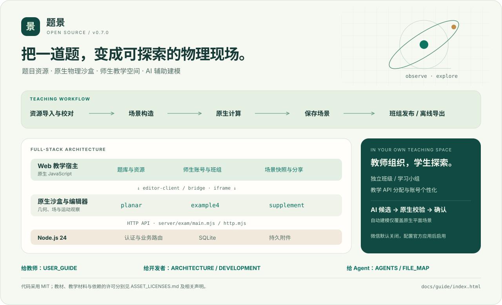
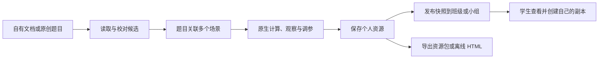
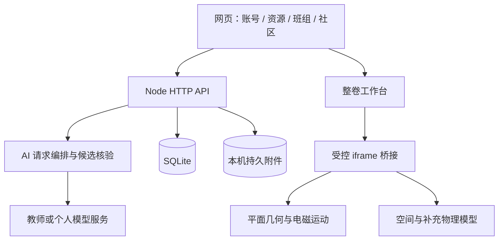

# 题景 Tijing

**把一道物理题，变成可以观察、探究和分享的场景。**



题景是一套面向教师与学生的全栈物理学习工具：从文档整理题目，在原生沙盒中构造几何与电磁场，观察运动、调参和保存变式，再将资源或任务发布到自己的班级与学习小组。网页端具备独立师生账号、个人空间、社区、创意工坊与可选 AI 助手；同一套工作台还可用于 Electron 桌面端与离线资源导出。

| 项目状态 | 说明 |
| --- | --- |
| 产品版本 | **v0.7.0** |
| 开源整理批次 | `open-source.1`，2026-10-14 |
| 上游来源 | `web-v0.7.0` / `e98b3f2395d91f90a224235ff840998cb13e8f1b` |
| 技术基础 | 原生 JavaScript / Node.js 24 / SQLite / Three.js / Electron |
| 代码许可 | [MIT](LICENSE) |
| 教学材料 | 已确认可公开再分发，独立登记于 [ASSET_LICENSES.md](ASSET_LICENSES.md)；不自动改为 MIT |
| 微信 | 接入代码保留，默认关闭；需官方应用、域名与凭据后另行开通 |

这份目录是**从已部署版本导出的源码整理版**：核心业务与计算代码来自上述提交，调整了包元数据、文档、默认入门示例及本机路径。它不包含原部署的用户数据库、头像、私人附件、API 密钥或 Git 历史。详见 [PROVENANCE.json](PROVENANCE.json) 与 [导出说明](docs/EXPORT_NOTES.md)。

## 先从这里开始

| 你想做什么 | 从哪里进入 |
| --- | --- |
| 直观了解整个项目 | 双击 [离线可视化导览](docs/guide/index.html)，或阅读下方功能介绍 |
| 自己部署一套供师生使用 | [部署与运行](docs/DEPLOYMENT.md) |
| 作为教师备课、发任务、建班 | [教师与学生使用指南](docs/USER_GUIDE.md) |
| 看清前后端、沙盒与 AI 的关系 | [架构说明](docs/ARCHITECTURE.md) |
| 用 Agent 接手开发 | 先读 [AGENTS.md](AGENTS.md)，再读 [文件地图](docs/FILE_MAP.md) |
| 修改、打包或贡献代码 | [开发指南](docs/DEVELOPMENT.md) · [贡献约定](CONTRIBUTING.md) |
| 核实代码、素材与依赖许可 | [资产许可](ASSET_LICENSES.md) · [第三方组件](THIRD_PARTY_NOTICES.md) |

可视化导览是仓库内的独立 HTML，不需要账号、网络或外部 CDN。GitHub 等代码托管平台通常不会直接执行 HTML，请下载后打开；README 中的 SVG 与 Mermaid 可直接阅读。

## 复制给 Agent 的接手 Prompt

将下面整段复制给你的编码 Agent，填写项目路径和开发需求即可。

```text
你是本项目的开发协作 Agent，请协助我探索“题景”源码、进行二次开发并完成本地部署。

项目路径：【填写解压后的目录】
开发需求：【填写希望修改的功能；暂无则填写“先部署体验”】

1. 先阅读 AGENTS.md、README.md、PROVENANCE.json，以及 docs 下的 FILE_MAP、ARCHITECTURE、DEVELOPMENT、DEPLOYMENT 文档，再按需求查看相关代码。简要说明项目结构、启动方式和涉及的模块，不要只凭文件名推测。
2. 有关键歧义时集中澄清；涉及功能开发时，先说明预期效果、改动范围和验收方式，确认后自主完成。仅部署体验时直接执行。
3. 复用现有结构，保持无关功能和物理计算逻辑不变。使用 Git 留下清晰记录，保留已有改动，不提交密钥、真实学生数据或运行数据；遵守代码及教学素材的许可说明。
4. 按部署文档检查运行环境、安装依赖、配置本地环境并构建启动。需要我提供的密钥或账号明确列出，不要编造；无需外部服务的部分继续完成。
5. 围绕改动执行必要验证，并实际检查本地页面能否访问、关键流程能否使用。不要只给操作建议，也不要无理由扩大测试范围。
6. 最后简要交付：完成内容、访问地址、启动与停止方法、修改文件、实际验证结果，以及尚未完成或需我配置的事项。
```

## 能做什么

| 场景 | 已有能力 | 使用边界 |
| --- | --- | --- |
| 物理探究 | 平面带电粒子、几何构造与持续依赖、区域电磁场、合场显示、点探针、时间轴、运动曲线 | 参数单位与关系由原生模型定义；演示数值不等于外部题目的条件 |
| 整卷备课 | PDF、DOCX、图片导入候选，人工校对，题目与多个场景关联，复制变式、保存与导出 | 原稿解析结果需要核对，扫描图不等于已获得可靠题干 |
| 教学组织 | 教师自助注册、独立班级和学习小组、投送资源、学习任务与评阅 | 学生保留一个行政班、可属于多个学习小组 |
| 账号与个人空间 | 平台管理员、教师、学生；头像、背景、简介、签名、兴趣标签 | 个人展示资料对已登录平台用户可见；真实数据由各部署自行建立 |
| AI 辅助 | 教师默认连接、班组专属连接、个人 API；答疑、资料处理、场景候选、原生核验 | 自动场景生成仅支持原生平面场景；候选确认后才应用；模型调用可能计费 |
| 分享与交流 | 班组发布快照、创意工坊、二创、讨论与反馈 | 私有原稿和公开快照具有不同的访问边界 |
| 桌面与离线 | Electron 本机工作台、整卷资源包、可导出的离线 HTML | 网页账号、服务器保存与模型调用仍需要相应服务 |

## 五步在本机启动

使用 **Node.js 24.14 或更新的 24.x**，版本上限为 25。网页核心不需要另装数据库服务，SQLite 由 Node 内建模块提供。

```sh
# 1. 在本项目根目录安装锁定依赖
npm ci

# 2. 构建网页、沙盒和不含私人资料的入门示例
npm run build:web

# 3. 将 server/exam/.env.example 复制为根目录 .env
# Windows PowerShell: Copy-Item server/exam/.env.example .env
# Linux / macOS: cp server/exam/.env.example .env

# 4. 在交互终端创建初始教师／平台管理员
npm run setup:web

# 5. 启动服务
npm start
```

打开 **http://127.0.0.1:8080/**。首次初始化的账号和密码由你自己设置，不存在随源码附带的可用管理员账号。登录后可创建班级，或点击“体验入门示例”观察三个通用演示。

仅用网页端、不需要 Electron 时，可以在 `npm ci` 前设置 `ELECTRON_SKIP_BINARY_DOWNLOAD=1`，避免下载桌面运行时；两种系统的完整命令见 [部署指南](docs/DEPLOYMENT.md)。PDF 和旧 DOC 文档处理所需的 Poppler、antiword 等可选系统组件，也在该指南中说明。

**没有模型 API Key 也能使用账号、资源和原生沙盒。** 配置模型连接后才可使用相应 AI 功能。不要把真实密钥写入 `.env.example`、题目资源或版本库。

## 一个完整的教学流程



教师修改私稿不会自动改掉已发布快照；学生复制后的变式与原稿独立。AI 候选同样需要经过确认，不会因为预览成功就自动替换已保存的场景。

## 全栈结构



| 目录 | 作用 |
| --- | --- |
| `src/exam/` | 网页界面、整卷模型、文档读取与沙盒桥接 |
| `src/planar-*.mjs` | 平面物理、几何关系与原生交互 |
| `src/example4/`、`src/supplement/` | 空间组合场及补充模型 |
| `server/exam/` | HTTP、身份、资源、SQLite、AI 与 worker |
| `desktop/exam/` | Electron 与本机文件适配 |
| `scripts/` | 构建、示例生成、打包与检查 |
| `tests/` | 已有单元、接口和模型检查代码；夹具与真实资料分开 |
| `examples/` | 不依赖私人原稿的原创入门任务 |
| `assets/guide/`、`teaching/` | 按独立授权保留的教学资产与制作流程 |
| `docs/` | 导览、架构、部署、开发和保留的功能手册 |

## 版本与交付内容

- 产品版号来自 `src/exam/release-notes.json`，当前为 `0.7.0`；源码 `package.json`、Web 和桌面打包元数据已统一。
- `PROVENANCE.json` 记录上游提交、快照校验值、导出整理批次和主要改动。
- `docs/SOURCE_INDEX.json` 是供 Agent 定位的文件索引，避免无目的遍历大型素材文件。
- `PUBLIC_FILES.json` 是交付文件清单及 SHA-256；压缩包校验值位于交付目录的 `SHA256SUMS.txt`。
- 本地目录有独立 Git 仓库；分享用 ZIP 不带 `.git`。原服务器的提交历史及私有运维记录没有被复制进去。

```sh
# 公开包结构、版本、资源和文档链接检查
npm run check:public

# 生成独立 Web 运行包；输出目录须是新目录
npm run package:web -- --out=dist/tijing-web-package

# 可选：桌面端开发
npm run build:exam
npm run start:exam
```

`npm run build` 默认构建 Web 全栈入口；历史安培力单文件构建仍保留为 `npm run build:ampere`。完整命令及原专题验收脚本的适用范围见 [开发指南](docs/DEVELOPMENT.md)。

## 授权与参与

代码与本次新增原创说明采用 [MIT](LICENSE)。维护者确认可再分发的教材题图、题目文字和教学加工内容已保留；其具体来源、署名与详细使用范围在 [资产登记](ASSET_LICENSES.md) 中单独补充。**MIT 不自动覆盖第三方教学材料，也不覆盖第三方依赖自身的许可证。**

欢迎按自己的课程改编，或让 Agent 处理边界清楚的任务。先阅读 [贡献约定](CONTRIBUTING.md) 和 [安全说明](SECURITY.md)，提交时说明实际改动与必要验证，不上传学生资料、账号数据库或服务密钥。
