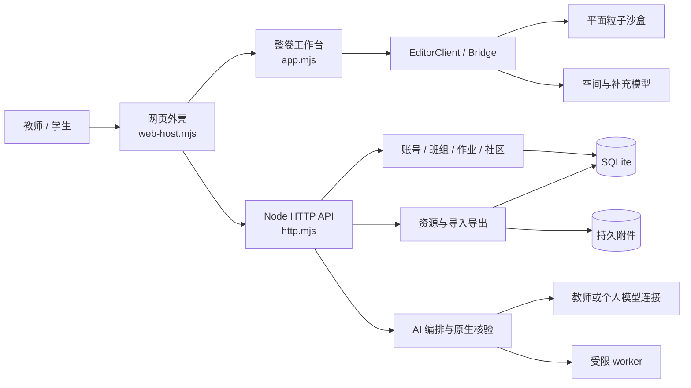
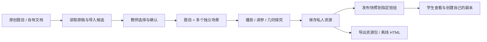
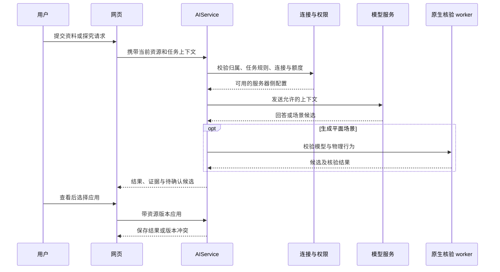

# Architecture · 系统架构与代码导览

[返回 README](../README.md) · [部署](DEPLOYMENT.md) · [开发](DEVELOPMENT.md) · [Agent 指南](../AGENTS.md)

本文以公开版 v0.7.0 的代码为准。题景把“试卷与题目”“可交互物理场景”“师生学习空间”放在同一套应用中。网页服务、桌面工作台和离线课件复用题目模型与沙盒运行时，但账号、班级、社区及模型连接由网页服务器提供。

## 1. 全栈关系



| 层 | 目录 / 关键文件 | 负责什么 |
| --- | --- | --- |
| 网页外壳 | `src/exam/web-host.mjs`、`web-*.mjs` / `.css` | 身份、首页、班组、任务、社区、工坊、AI 与账号设置 |
| 工作台 | `src/exam/app.mjs`、`model.mjs`、`resources.mjs` | 一份资源中的题目、场景、原稿、导入导出与保存状态 |
| 工作台导航 | `workspace-chrome.mjs`、`workspace-chrome.css` | 紧凑导航、浮动面板、个人布局 |
| 编辑器桥 | `editor-client.mjs`、`bridge.mjs` | 主页面与场景 iframe 之间的受控消息 |
| 平面物理 | `src/planar-*.mjs` / `.css` | 场域、粒子、运动、几何构造、参数依赖与图表 |
| 空间演示 | `src/example4/` | 特定空间组合场模型、Three.js 场景与 UI |
| 补充模型 | `src/supplement/` | 补充物理模型目录、求解器和演示界面 |
| 网页服务器 | `server/exam/` | 原生 Node HTTP、认证、访问控制、数据存储与模型服务 |
| 桌面端 | `desktop/exam/` | Electron 安全隔离、IPC、本机文件选择和保存 |
| 构建与发布 | `scripts/` | esbuild 打包、字体和 PDF 资源、网页压缩、运行包清单 |
| 教学内容 | `teaching/`、`docs/manuals/` 等 | 教学资源生成源、场景说明与使用指南 |

项目没有独立的前端框架运行时或外部数据库服务。前端主要是原生 ES modules 和 DOM / Canvas / Three.js；后端使用 Node 内建 HTTP 和 SQLite。KaTeX、MathLive、PDF.js、Sharp、fflate 等负责公式、PDF、图像与资源压缩。

## 2. 从题目到共享课件



核心数据格式定义在 [`src/exam/model.mjs`](../src/exam/model.mjs)：

- **Paper**：`particle-exam/1`，包含资源标识、题目列表、来源、附件字典和当前题目。
- **Question**：原题文字、参考内容、题图、备注、小问及多个场景。
- **Scene**：场景类型、当前快照、基线、状态和所属小问。
- **Snapshot**：`scene` 保存物理模型，`context` 保存观察时刻、视角及显示状态。显示上下文与模型条件应分开维护。
- **Asset**：附件元数据和服务器路径；导出便携资源时使用内嵌数据与校验值。

`validatePaper()` 和 `checkSnapshot()` 是导入、保存和跨运行时操作的共同约束。它们检查数据结构、标识、附件引用、场景类型与模型有效性；修改一条入口时不能绕开其他入口的校验。

文档导入分为“读取候选”和“确认写入”。网页端临时文件在持久目录的 `staging/`，确认前不应替换原资源。`service.mjs` 管理导入候选生命周期和同一用户的写入队列，`resources.mjs` 管理归属、配额、版本和公开快照。

发布到班组使用明确快照。教师后续编辑私人草稿不会自动改变学生已经看到的版本；重新发布才更新共享内容。工坊副本还记录来源信息。公开内容的修改权仍归作者或规定的管理路径。

## 3. 身份、班组与模型连接

| 身份 / 范围 | 实现与边界 |
| --- | --- |
| 平台管理员 | `users.platform_admin` 标记；可管理教师账号，不能由注册参数获得 |
| 教师 | 自助注册独立教学空间；管理自己负责的行政班、学习小组和教学 API |
| 学生 | 使用行政班邀请码注册；一个行政班，可属于多个学习小组 |
| 资源作者 | 私人资源读写由所有者控制；教师身份不自动带来读取他人原稿的权限 |
| 班组教学连接 | 默认继承负责教师的教学连接，可设置班级或小组专属连接 |
| 个人连接 | 用户自己的 API 配置；仍受作业 AI 政策与个人用量约束 |

入口文件：

- [`auth.mjs`](../server/exam/auth.mjs)：密码、注册、会话、账号管理。
- [`account-permissions.mjs`](../server/exam/account-permissions.mjs)：平台管理与学生账号管理边界。
- [`groups.mjs`](../server/exam/groups.mjs)：班级、小组、成员和资源目标范围。
- [`account-profiles.mjs`](../server/exam/account-profiles.mjs)：资料版本、图片归属、解码和重新编码。
- [`ai-settings.mjs`](../server/exam/ai-settings.mjs)：连接保存、继承、范围选择及旧配置迁移。

账号资料、已保存头像与背景对平台内已登录用户可见；未保存图片只用于本人预览。API 密钥保留在服务器私密文件中，浏览器只得到脱敏状态。教师停用、学生退出班组或归属改变后，新请求重新判断授权。

微信代码位于 [`wechat-accounts.mjs`](../server/exam/wechat-accounts.mjs)。公开版默认关闭，需要使用者自己的已审核网站应用、匹配的 HTTPS 回调域、凭证和实际联调。状态、票据和回调有浏览器与会话绑定；不能把昵称相同当成自动合并账号的依据。

## 4. 场景运行与 iframe 边界

网页工作台加载仓库构建出的 `planar.html`、`example4.html` 或 `supplement.html`，将 JSON 快照传给相应运行时。场景不携带可任意执行的用户程序。

`EditorClient` 管理 iframe，`attachExamBridge()` 运行在场景内。双方验证消息来源窗口，并用 token 与 generation 隔离当前题目和每次装载。切题时会清理未完成请求，避免旧消息写入新场景。主页面允许的能力限制为预设接口，工具栏动作也有白名单。

普通网页编辑器使用 iframe sandbox；只读 AI 候选仅允许脚本运行，不开放主页面编辑能力。桌面端使用 Electron 的独立加载机制、context isolation、禁用 Node integration 的窗口及受控 IPC，不能照搬其 iframe 配置到网页。

平面模型职责分工：

| 路径 | 内容 |
| --- | --- |
| `src/planar-model.mjs` | 对象结构、默认值、准备与校验 |
| `src/planar-physics.mjs` | 物理量换算、场与运动计算 |
| `src/planar-relations.mjs`、`planar-expressions.mjs` | 定义关系与表达式求值 |
| `src/planar-geometry.mjs`、`planar-constructions.mjs` | 几何对象及构造 |
| `src/planar-dependencies.mjs` | 对象依赖 |
| `src/planar-view.mjs`、`planar-field-display.mjs` | 绘制与场显示 |
| `src/planar-motion-readings.mjs`、`planar-motion-series.mjs` | 读数与时序数据 |
| `src/planar-app.mjs` 及 UI 模块 | 用户操作、面板和渲染协调 |

物理条件、演示数值和观察状态必须明确分开。对定义驱动的场景，修改自由参数应沿现有依赖系统传播，不能只同步一组初始数值。

## 5. AI 请求路径



`ai-service.mjs` 编排任务、用量、状态及应用；`model-provider.mjs` 适配模型请求；`model-network.mjs` 限制网络目标；`ai-docx-worker.mjs` 等处理文档；`ai-agent-worker.mjs` 与 `ai-harness-worker.mjs` 在受限工作线程内处理原生场景操作和核验。

AI 生成目前针对平面模型，不能泛化成“任意物理题均能自动建模”。空间与补充模型可手工探究或答疑。候选标注、演示假设和教师确认仍是教学流程的一部分。

## 6. 构建与数据分离

```text
源码：src/ + server/ + desktop/ + scripts/ + 教学源文件
  └─ npm run build:web
       └─ dist/exam/：页面、脚本、样式、PDF 资源、沙盒、原创示例
            └─ npm run package:web -- --out=新的目录
                 └─ 运行包：服务器 + worker + 静态资源 + 依赖锁 + 文件清单

运行配置：部署者自己创建的 .env
持久数据：EXAM_DATA_DIR（数据库、附件、头像、模型配置等）
```

源码可以公开，运行配置和使用者数据不能随源码公开。教师授权分享的教学材料保留在交付中，来源与许可范围按照材料说明维护；它们与平台用户后续上传的私密资料是不同资产。

网页运行包由 esbuild 打包后端及相邻 worker，保留 Sharp、fflate、XML 解析等运行依赖。发布包清单记录文件大小和 SHA-256；文件清单说明包内内容，不证明业务功能或真实模型、微信服务已经验收。
