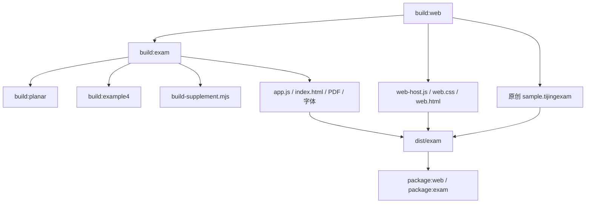

# Development · 开发与维护指南

[返回 README](../README.md) · [架构](ARCHITECTURE.md) · [部署](DEPLOYMENT.md) · [Agent 指南](../AGENTS.md)

本指南帮助贡献者定位代码、重建产物和选择适用检查。先完成 [部署指南](DEPLOYMENT.md) 中的本机环境准备。默认开发对象是网页全栈；桌面和独立教学 HTML 是复用同一模型的其他出口。

## 1. 版本与构建入口

公开版产品名为 `tijing`，版本为 `0.7.0`。维护版本时同步 `package.json` / 锁文件与 [`src/exam/release-notes.json`](../src/exam/release-notes.json) 的最新记录。Web 和桌面发布脚本使用产品更新记录生成版号。

| 命令 | 作用 |
| --- | --- |
| `npm ci` | 按锁文件安装源码构建依赖 |
| `npm run build` | 默认构建网页，与 `build:web` 相同 |
| `npm run build:web` | 构建网页、整卷工作台、三个沙盒运行时和原创示例 |
| `npm run build:sample` | 单独生成公开原创示例，无私人附件 |
| `npm run setup` / `setup:web` | 从根目录 `.env` 读取配置，交互初始化首位教师 |
| `npm start` / `start:web` | 从根目录 `.env` 读取配置，启动 Node 服务 |
| `npm run check:runtime` | 检查当前机器的 Node、Sharp、静态资产及文档命令 |
| `npm run build:planar` | 构建平面沙盒单文件 HTML |
| `npm run build:example4` | 构建空间组合场单文件 HTML |
| `npm run build:lorentz` | 构建独立洛伦兹力教学演示 |
| `npm run build:exam` | 构建整卷工作台及其依赖运行时 |
| `npm run start:exam` | 运行 Electron 桌面工作台 |
| `npm run package:web -- --out=dist/新的目录` | 生成独立网页运行包 |
| `npm run package:exam -- --out=dist/新的目录` | 在 Windows x64 生成桌面便携包 |

`build:web` 是一次性构建，没有默认热更新服务器。修改前端源文件后重新构建，再刷新页面；修改后端后重新启动本机进程。不要在同一持久目录同时启动两个服务。

网页-only 开发可以在 `npm ci` 时设置 `ELECTRON_SKIP_BINARY_DOWNLOAD=1`，但不能省略 esbuild 等源码构建依赖。需要桌面运行时再恢复 Electron 二进制，详见 [部署指南](DEPLOYMENT.md)。

### 构建依赖图

构建会生成独立 HTML、打包脚本、内嵌字体及 PDF 资源；网页入口带内容哈希，并生成 gzip / Brotli 资源。改 UI 时应修改 `src/`，不要手工修改这些生成文件。

## 2. 任务到源码的映射

| 要修改的行为 | 先读 | 再检查的关联 |
| --- | --- | --- |
| 登录、注册、会话 | `server/exam/auth.mjs`、`http.mjs` | `account-permissions.mjs`、`src/exam/web-host.mjs` |
| 账号资料、头像、封面 | `account-profiles.mjs`、`src/exam/web-account-center.mjs` | `web-account-center.css`、`forum.mjs` 的公开展示 |
| 班级、小组、邀请码 | `server/exam/groups.mjs`、`src/exam/web-groups.mjs` | `auth.mjs`、资源发布目标和 API 选择 |
| 教师教学 API、学生来源 | `server/exam/ai-settings.mjs`、`src/exam/web-ai-settings.mjs` | `model-network.mjs`、`ai-service.mjs`、成员资格 |
| 资源权限、保存、并发 | `server/exam/resources.mjs` | `model.mjs`、`service.mjs`、发布快照和作业关联 |
| DOCX、PDF、图片导入 | `src/exam/documents.mjs`、`docx-parser.mjs`、`pdf-browser.mjs` | `server/exam/service.mjs`、`ai-documents.mjs`、附件配额 |
| 试卷结构与导入导出 | `src/exam/model.mjs`、`resources.mjs` | `desktop/exam/backend.mjs`、服务器同名资源模块 |
| 工作台导航和面板 | `workspace-chrome.mjs`、`workspace-chrome.css` | `app.mjs`、移动端和 iframe 区域尺寸 |
| 原生沙盒工具栏 | `src/exam/bridge.mjs`、`editor-client.mjs` | `planar-app.mjs`、工具白名单和只读模式 |
| 平面运动结果 | `src/planar-physics.mjs`、`planar-model.mjs` | `planar-relations.mjs`、场边界、时间线与读数 |
| 动态几何与参数依赖 | `planar-relations.mjs`、`planar-geometry.mjs`、`planar-expressions.mjs` | `planar-dependencies.mjs`、构造 UI、循环依赖处理 |
| 场显示、颜色、标签 | `planar-view.mjs`、`planar-field-display.mjs`、`planar-object-style.mjs` | 视图状态、样式对话框、模型值不得随样式变化 |
| 时间轴、轨迹、图表 | `planar-timeline*.mjs`、`planar-motion-*.mjs` | 求解器、观察时刻、窗口与采样单位 |
| 空间演示 | `src/example4/physics.mjs`、`scene.mjs`、`app.mjs` | `model.mjs` 的对应快照校验 |
| 补充物理模型 | `src/supplement/catalog.mjs`、`models.mjs`、`physics.mjs` | `scene.mjs`、`app.mjs`、快照校验 |
| AI 场景生成与核验 | `ai-service.mjs`、`ai-agent-tools.mjs`、`ai-harness.mjs` | worker、`ai-validation.mjs`、`ai-grounding.mjs` |
| AI 当前题目上下文 | `ai-context.mjs`、`ai-sources.mjs`、`ai-prompts.mjs` | 任务规则、原稿选择、资源归属 |
| 作业、反馈、社区、工坊 | `assignments.mjs`、`feedback.mjs`、`forum.mjs`、`workshop.mjs` | 对应 `src/exam/web-*.mjs` 和发布范围 |
| 版本公示 | `src/exam/release-notes.json`、`web-updates.mjs` | `scripts/check-release-notes.mjs`、打包版号 |
| 桌面文件或 IPC | `desktop/exam/main.mjs`、`preload.cjs`、`backend.mjs` | 主窗口 sender 校验、路径与资源格式 |

除明确标出 `src/` 的文件外，表中的后端短文件名位于 `server/exam/`；`planar-*` 位于 `src/`。查找可使用 `rg -n "关键函数" src server scripts`。

## 3. 开发过程中的数据选择

本机开发使用自己创建的空数据目录和虚构账号。需要多角色调试时，在本机注册教师、学生并创建示例班组；不要把真实学生库或部署者密钥复制进源码。

推荐给本机 `.env` 设置一个专用 `EXAM_DATA_DIR`。更换目录等于使用另一套独立数据，需重新初始化，不能把它误认为原数据丢失。不要将本机端口变更与公共实例混用。

数据与代码的边界：

| 内容 | 所在位置 | 是否进入公开源码 |
| --- | --- | --- |
| 产品源代码、模型、样式、构建脚本 | `src/`、`server/`、`desktop/`、`scripts/` | 是 |
| 经授权保留的教学材料和教学源文件 | 相应材料目录、`teaching/` | 按材料授权说明保留 |
| 新安装生成的原创示例 | `dist/exam/sample.tijingexam` | 由源码再生成，运行包可含 |
| 用户、会话、任务、资源记录 | 持久目录中的 SQLite | 否 |
| 附件、头像、背景、私密 AI 配置 | 持久目录 | 否 |
| 本机环境、密码、API Key、微信 AppSecret | `.env` 或部署秘密配置 | 否 |
| 构建产物、测试产物和运行日志 | `dist/`、临时输出目录 | 不作为源文件提交 |

教师已授权分享的原有教学材料继续保留。授权或署名细节尚待补齐时，维护来源记录，不把它们改成“全部自动适用 MIT”。新增素材应一并说明来源和分发条件。

## 4. 原创示例与教材脚本

`npm run build:sample` 用模型构造函数生成公开原创示例，不读取私人 DOCX，不包含原稿、题图或账号数据。它为“打开示例”和首次打包提供稳定入口。

原有教材样例生成脚本以 `scripts/build-textbook-sample.mjs` 名称保留，可通过 `npm run build:textbook-sample -- "教材.docx"` 从指定教材 DOCX 构建包含题目与场景的资源。它按特定例题编号和题型匹配，不是通用任意 DOCX 自动建模器；不属于 `build:web` 的必需输入。

调用教材样例脚本时，先读该脚本顶部的参数和输出目录，再提供自己持有授权的源文件。`teaching/` 中按日期组织的课堂资源脚本也属于专用教学流程，可能依赖它们自己的解析中间结果；按各目录说明准备材料，不把历史个人路径或中间结果当成所有贡献者都具备的环境。

## 5. 有针对性的验证

只执行本次修改需要的检查；以下是选择表，不是每次都要跑完的清单。文档改动不需要建立新测试系统，纯样式改动也不默认运行所有物理和服务器测试。真实模型调用与微信联调另计，不能用本地合成测试冒充。

| 修改类型 | 优先验证 |
| --- | --- |
| README / 文档 | 检查本地链接、命令是否存在、路径与实际目录一致 |
| 构建与版本 | `npm run build:web`；`node scripts/check-release-notes.mjs`；检查目标包版号与文件清单 |
| 账号与权限 | `node --test tests/exam-account-system.test.mjs`，再按受影响范围选择 Web / community 测试 |
| 微信协议实现 | `node --test tests/exam-wechat-accounts.test.mjs`；这只是合成协议验证 |
| 工作台模型、格式 | `npm run test:exam`；必要时选择相关资源导入测试 |
| iframe 桥与工具栏 | `node --test tests/exam-editor-host.test.mjs tests/exam-editor-toolbar.test.mjs` |
| 平面物理 | `node --test tests/planar-physics.test.mjs` 及受影响模型对应文件 |
| 几何关系 | `node --test tests/planar-relations.test.mjs tests/planar-geometry.test.mjs`，按改动补选对应构造测试 |
| 空间演示 | `npm run test:example4` |
| AI 连接和策略 | `tests/exam-ai-settings.test.mjs`、任务上下文和具体 AI 模块对应测试 |
| UI / 响应布局 | 构建后在本机浏览器查看本次变更入口、窄屏、焦点与相关沙盒区域 |
| 部署依赖 | `npm run check:runtime`，使用实际服务账号的环境 |

`npm test` 是仓库完整 Node 测试集合；`test:web`、`test:planar` 是已有分组。只在目标范围需要时使用。旧命名的浏览器脚本可能针对特定教学页面，不应把所有 `check:*` 当作整个网站的同一种验收。

对物理改动，验证应能说明理论关系和轨迹行为为何正确；只比较生成文件或枚举数值不能代替连续定义关系的检查。对 UI 改动，关注主页面、工作台与 iframe 的布局关系，而不只是“没有抛异常”。

## 6. 常见修改的约束

### 改身份与账号

服务器从已验证会话取身份，不信任提交的 `owner_id`、role 或管理员标记。新增管理界面时复用权限函数，不只在前端隐藏按钮。保留教师间隔离、学生行政班归属、版本冲突、停用后的会话失效与审计。

### 改模型 API

API 配置的三个层级是教师默认、班组专属、用户个人。变更服务商地址时不能把旧密钥发给新域名；界面和接口都只返回脱敏值。成员资格和教师状态要在新请求时校验。模型网络层的公共 HTTPS 目标限制不要改成宽泛的 `fetch(url)`。

### 改场景或工作台

让题目、场景、基线和当前观察状态保持独立。不要在调整 UI 时改写模型条件。新增快照字段同时考虑校验、导入导出、桌面运行与原生核验；新增 iframe 能力需明确允许的调用方、token/generation 与只读行为。

### 改数据库

当前迁移集中在数据库及业务模块初始化路径，没有独立迁移框架。先读已有列检测和建表逻辑，再采用可重复执行的必要变更；提供旧数据升级和回退影响说明。不能通过删库“修复”迁移问题。

## 7. 发布操作

1. 将改动说明与产品版本写入更新记录，保持日期、版本顺序和纯文本规则。
2. 对本次变更执行必要检查并记录实际结果，明确未执行部分。
3. 生成独立运行目录，不覆盖旧包；对照 manifest 核实包内内容。
4. 公开包只含代码、文档和获授权的材料，不含使用者数据或配置。
5. 目标实例的停服备份、切换和回退按 [部署指南](DEPLOYMENT.md) 执行。

提交说明描述“什么触发了旧问题、现在怎样表现、怎样验证”。不把构建成功称为上线，不把模拟模型响应称为真实供应商验收，也不把待配置的微信登录列为已开通功能。
